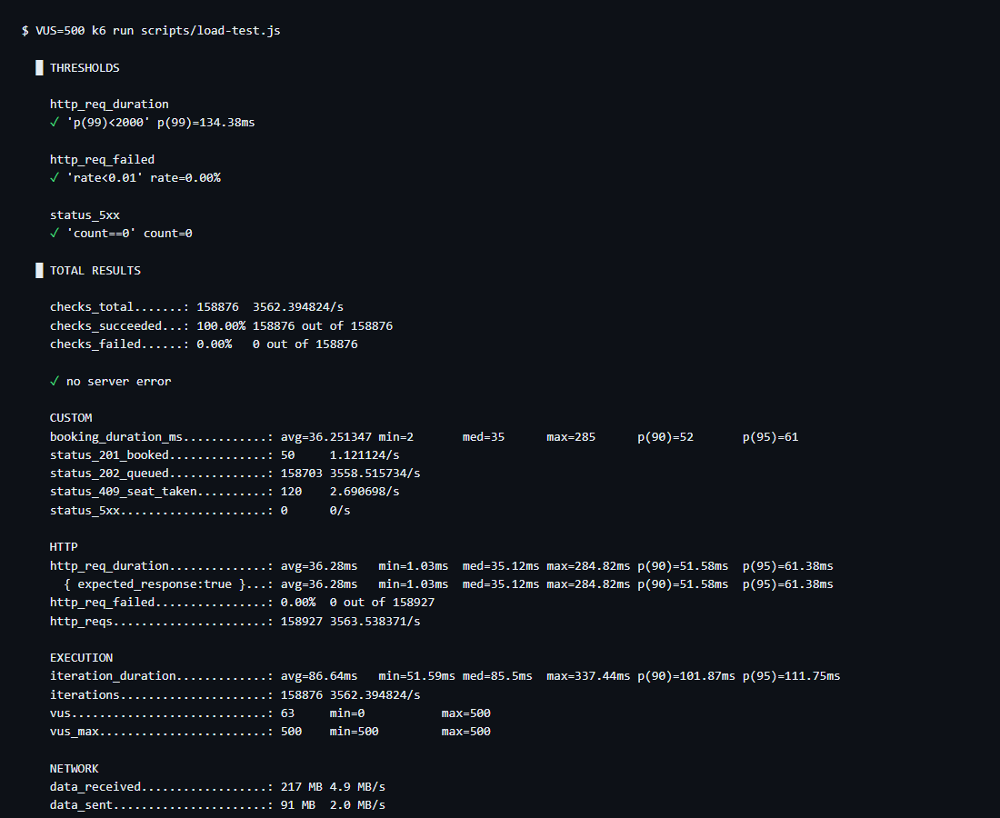
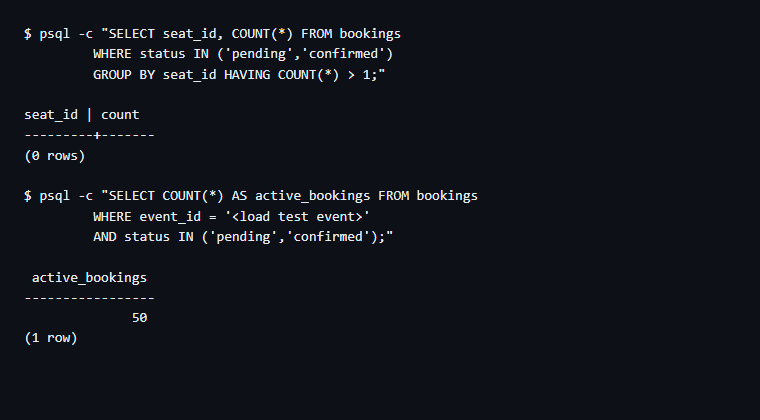
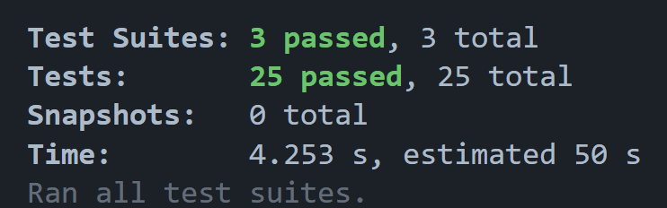

# TicketVault

A ticket booking app built to handle a lot of concurrent users trying to book the same seat at the same time, without ever creating a double-booking.

**Live demo:** https://ticketvault-app.vercel.app
**Demo login:** `user@ticketvault.com` / `user123`
**Admin:** `admin@ticketvault.com` / `admin123`

---

## What it does

You can browse events, pick a seat, hold it for 10 minutes, and then pay (the payment is simulated). The seat map updates in real time over WebSocket, so you can see other people's bookings come in while you're looking at the page.

The core engineering challenge: when 500 virtual users (k6) hit 'reserve' on the same seat simultaneously, only one booking should actually go through. The rest should get a clean response, not a duplicate row in the database and not a 500 error.

---

## How double-booking is prevented

When the same seat is requested by many users at once, four things stack on top of each other to make sure only one booking happens:

### 1. Redis Lua atomic decrement

Inventory is decremented inside a small Lua script. Redis runs Lua atomically, so two requests can't both see "1 left" and both pass through the check.

```lua
local v = redis.call('GET', KEYS[1])
if not v then return -2 end
if tonumber(v) <= 0 then return -1 end
return redis.call('DECR', KEYS[1])
```

### 2. PostgreSQL row-level lock

Before changing the seat row, the booking transaction grabs a lock on it. The `NOWAIT` keyword makes the second request fail straight away instead of waiting in a queue:

```sql
SELECT * FROM seats WHERE id = $1 FOR UPDATE NOWAIT
```

The error handler catches the lock-failed error and returns HTTP 423 so the client sees a clean response instead of a generic 500.

### 3. Status check inside the transaction

Even with the lock acquired, the seat status is checked one more time before the booking is written. Just an extra check in case some other code path changed the seat in between.

### 4. Partial unique index

The first three layers live in application code. The last one is in the database itself, so a double booking is impossible even if the code has a bug:

```sql
CREATE UNIQUE INDEX uniq_active_booking_per_seat
  ON bookings(seat_id) WHERE status IN ('pending','confirmed');
```

A seat can have any number of expired or cancelled bookings, but only one active one. If an insert breaks this rule, Postgres rejects it and the API returns 409.

### How it's tested

The integration test in `tests/integration/bookingFlow.test.ts` fires 50 concurrent booking requests for the same seat. Exactly one becomes a booking. The other 49 are queued or fail cleanly. Another test inserts a second active booking straight into the table, bypassing the app, and checks that Postgres rejects it. Two more cover expiry worker races: a payment that lands while the worker is expiring the booking, and two workers expiring the same booking. In both cases the seat must be released at most once. These tests run on every push to GitHub.

---

## Performance

Tested with k6 against the production build of the backend, running locally on a laptop with Postgres and Redis in Docker. Each run uses a fresh 50-seat event and 50 test users, and lasts 35 s (10 s ramp up, 20 s hold, 5 s ramp down). Rate limits were raised for these runs so every request goes through the full booking path (Lua gate, row lock, transaction). The limits are still checked in Redis on every request.

| Test | VUs | Requests | Booked (201) | Queued (202) | Seat taken (409) | 5xx | Doubles in DB | p99 latency | Throughput |
|---|---|---|---|---|---|---|---|---|---|
| Load | 100 | 48,024 | 50 | 47,746 | 177 | 0 | 0 | 22 ms | 1,084 req/s |
| Stress | 500 | 168,667 | 50 | 168,267 | 298 | 0 | 0 | 62 ms | 3,813 req/s |

Laptop numbers vary between sessions (p99 at 500 VUs has ranged from about 60 to 135 ms with the same code), so only compare runs made back to back.

Once all 50 seats are taken, the Redis counter hits 0 and every further request is put on the waitlist (202) without touching Postgres.

**Event cache.** The booking path used to load the event from Postgres on every request (a join plus a count over all seats), even for requests that only end up on the waitlist. With 20 pool connections, requests queued up waiting for one. Event details are now cached in memory for 5 seconds, and the seat count still comes live from Redis. At 500 VUs, measured back to back, this took throughput from 1,945 to 3,564 req/s and p99 from 191 ms to 134 ms.

**Redis-backed rate limits.** Rate-limit counts are kept in Redis, so all server instances share one count per user and per IP, and counts survive restarts. With the old in-memory store, a user could make N times the limit across N instances. Against the in-memory store, back to back, it made no measurable difference (3,800 vs 3,627 req/s). If Redis goes down, the limiter lets requests through instead of blocking everyone.

After every test, the database is checked directly for any seat with more than one active booking:

```sql
SELECT seat_id, COUNT(*) FROM bookings
WHERE status IN ('pending','confirmed')
GROUP BY seat_id HAVING COUNT(*) > 1;
```

Result every time: `(0 rows)`.





Full k6 output for both runs is in [`docs/k6-100VU.txt`](docs/k6-100VU.txt) and [`docs/k6-500VU.txt`](docs/k6-500VU.txt).

---

## Tech stack

| Part | Tech |
|---|---|
| Backend | Node.js 20, TypeScript, Express |
| Database | PostgreSQL 16 |
| Cache and Lua scripts | Redis 7 (ioredis) |
| Real-time | Socket.IO with Redis adapter |
| Auth | JWT plus single-use refresh tokens |
| Frontend | React 18, Vite, Zustand |
| Tests | Jest (unit, integration, e2e), k6 (load) |
| CI | GitHub Actions (typecheck + all Jest suites against Postgres and Redis on every push) |
| Hosting | Render (API), Neon (Postgres), Upstash (Redis), Vercel (frontend) |

---

## Features

- Browse events with a live seat map
- Reserve a seat with a 10-minute hold and visible countdown
- `Idempotency-Key` header on the booking endpoint so client retries never create duplicate bookings. Keys are scoped per user, reusing a key for a different seat returns 422, and a retry that arrives while the first request is still running gets 409 instead of being processed twice
- Waitlist queue when an event is sold out, with position tracking. When a seat frees up, it's reserved for the next person in line and they get a live alert with a "Pay now" button
- Real-time seat availability updates over WebSocket
- Simulated payment with success and failure paths; a failure releases the seat back to inventory
- JWT auth with single-use refresh-token rotation (if a rotated token is reused, the client gets 401). The server refuses to start without `JWT_SECRET`
- Admin dashboard with bookings, revenue, audit log, and live event occupancy
- Background worker that releases stale reservations every 30 seconds. It re-checks the booking under a row lock, so a payment that arrives at the same moment wins. A Redis lock makes sure only one server instance runs it at a time
- Reconciliation job that checks the Redis seat counters against Postgres every 5 minutes and fixes any drift (for example after a crash between the Redis decrement and the Postgres commit). It only fixes a mismatch that is still there on the next run, so a booking in flight never triggers a false fix

---

## Architecture

```
Browser (React + Socket.IO client)
        |
        | HTTPS / WSS
        v
Express API (Node 20)
        |
        +--> Postgres -- bookings, seats, events, audit log
        |
        +--> Redis ---- inventory counter, waitlist queue,
        |               idempotency keys, reservation TTLs,
        |               rate-limit counts
        |
        +--> Socket.IO  seat-state broadcast via Redis Pub/Sub
```

What happens when someone clicks "reserve seat":

1. Claim the idempotency key in Redis with `SET NX`. If the same key has been seen recently, the cached response is returned.
2. Decrement the inventory counter using the Lua script.
3. If the counter was already 0, push the user onto the waitlist queue and return HTTP 202.
4. Otherwise open a Postgres transaction.
5. Lock the seat row with `SELECT FOR UPDATE NOWAIT`.
6. Mark the seat reserved, insert the booking row, and write the audit log entry.
7. Set the 10-minute reservation TTL in Redis.
8. Broadcast the seat update over WebSocket so other browsers see it immediately.

---

## Run it locally

You need Node 20+, Docker Desktop, and Git.

```bash
# 1. Start Postgres and Redis
docker compose up -d postgres redis

# 2. Backend
cd backend
cp .env.example .env
npm install
npm run migrate
npm run seed
npm run dev          # runs on http://localhost:3000

# 3. Frontend (in a new terminal)
cd frontend
npm install
npm run dev          # runs on http://localhost:5173
```

The seed creates a 500-seat event and two demo accounts: `user@ticketvault.com / user123` and `admin@ticketvault.com / admin123`.

---

## Tests

```bash
cd backend

# Unit tests for the Redis Lua scripts and the idempotency primitive
npx jest --testPathPattern="tests/booking.test.ts"

# Integration tests against real Postgres and Redis (this is where the 50-concurrent proof lives)
npx jest --testPathPattern="tests/integration"

# End-to-end tests over HTTP, including the simulated payment flow
npx jest --testPathPattern="tests/e2e"
```

All 36 tests pass against a freshly migrated database.



### Load test (k6)

Build the backend and start it with raised rate limits. All virtual users share one IP, so the per-IP limit would otherwise answer almost every request with a 429:

```bash
cd backend
npm run build
NODE_ENV=production RATE_LIMIT_MAX=1000000 BOOKING_RATE_LIMIT_MAX=1000000 node dist/server.js
```

Then seed an event and run the test:

```bash
SEATS=50 ./scripts/seed-load-test.sh          # prints EVENT_ID and SEAT_IDS
EVENT_ID=... SEAT_IDS=... VUS=500 k6 run scripts/load-test.js
```

The script registers a pool of test users (50 by default, `USERS=` to change it) and spreads the virtual users across them. Responses are counted by status code (`status_201_booked`, `status_202_queued`, `status_409_seat_taken`, `status_429_rate_limited`, `status_5xx`). 4xx responses are expected under contention. The test fails only on 5xx errors or slow p99 latency.

To see the per-user booking limit at work, leave `BOOKING_RATE_LIMIT_MAX` at its default of 5 per minute. Most requests then come back as 429.

---

## Project structure

```
ticketvault/
├── .github/workflows/ci.yml      Typecheck + tests on every push
├── backend/
│   ├── src/
│   │   ├── routes/               auth, events, bookings, payments, admin
│   │   ├── services/
│   │   │   ├── booking/          Lua gate, row lock, waitlist
│   │   │   ├── payment/          Simulated pay, success/fail handling
│   │   │   ├── event/            CRUD, surge pricing, seat-map generation
│   │   │   └── websocket/        Socket.IO with Redis adapter
│   │   ├── workers/              Reservation expiry, seat counter reconciliation
│   │   ├── middleware/           auth, rate limit, refresh-token rotation
│   │   ├── redis/                ioredis client and 5 Lua scripts
│   │   └── db/                   Schema, migration, seed
│   └── tests/                    Unit, integration, end-to-end
├── frontend/src/                 React + Vite app
├── scripts/load-test.js          k6 load test
├── docs/                         Load test results and screenshots
└── docker-compose.yml            Local Postgres + Redis
```
